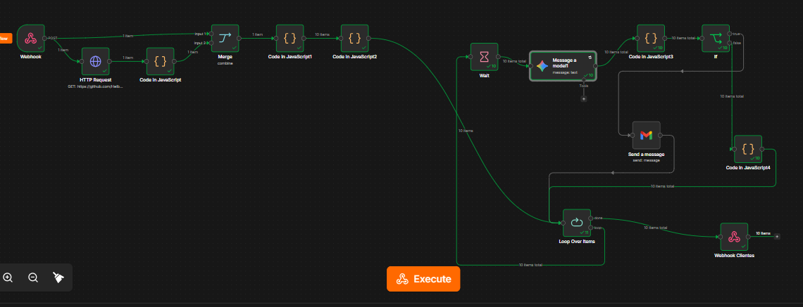

# Assistente de Investimentos com RPA, n8n e IA Generativa

Projeto educacional do desafio DIO **Criando um Assistente de Investimentos com RPA e IA Generativa**.

## Objetivo

Automatizar a extração de clientes fictícios de uma página HTML, consultar um catálogo CSV de investimentos, relacionar produtos ao perfil e ao saldo, gerar mensagens educacionais personalizadas com Google Gemini e controlar o envio por Gmail.

> **Aviso:** os produtos, os clientes e as rentabilidades são utilizados para demonstração. O fluxo não realiza análise de suitability completa nem fornece recomendação financeira individual.

## Tecnologias

- **Python + Requests + BeautifulSoup:** extração dos clientes de uma página pública simulada.
- **Google Colab:** execução do notebook Python.
- **ngrok:** túnel HTTPS temporário para o Webhook do n8n local.
- **n8n:** Webhook, HTTP Request, Code, Merge, Loop Over Items, Wait, IF e Respond to Webhook.
- **Google Gemini:** redação de mensagens personalizadas.
- **Gmail:** envio de e-mails para destinatários explicitamente autorizados.

## Arquitetura

```text
GitHub Pages (clientes)
  -> Python/BeautifulSoup
  -> POST Webhook n8n
     |-> HTTP Request (data.csv via RAW GitHub)
     |-> Webhook (dados dos clientes)
  -> Merge
  -> Code1 (perfil, saldo e opções)
  -> Code2 (briefing)
  -> Loop Over Items (lote = 1)
       -> Wait -> Gemini -> Code3 (normalizar a resposta) -> IF
            |-> True: Gmail -> Registrar Email Enviado -----|
            |-> False: Registrar Email Rejeitado -----------|-> próximo item
  -> Done -> Relatorio Final -> Respond to Webhook
```

## Estrutura de entrega

```text
n8n/workflow.json
docs/capturas/workflow_execucao_10_clientes.png
README.md
```

Os arquivos de origem do desafio (por exemplo, `docs/index.html`, `docs/data.csv` e o notebook de extração) devem permanecer no repositório. **Não os substitua pelo pacote de entrega.**

## Como executar

1. Inicie o n8n localmente (`n8n.cmd start`) e importe `n8n/workflow.json`.
2. Configure as credenciais do **Google Gemini** e do **Gmail** na sua própria instância. As chaves não fazem parte do arquivo exportado.
3. No HTTP Request, confira que a URL é:
   `https://raw.githubusercontent.com/Helber10/dio-lab-assistente-investimentos-rpa-n8n/main/docs/data.csv`
4. No IF, mantenha a lista `autorizados = []` para bloquear todos os envios reais durante os testes. Para envio autorizado, use **somente destinatários reais sob seu controle ou que tenham consentido**.
5. Abra um túnel ngrok para a porta local `5678`, somente em ambiente de laboratório protegido.
6. No Google Colab, configure o `POST` para o endereço HTTPS atual do ngrok com o caminho `/webhook-test/Clientes`, inicie a escuta de teste no Webhook e execute o notebook de extração.
7. Verifique os itens processados, as mensagens geradas e o relatório final no n8n. Não execute o Gmail com destinatários fictícios.

O Webhook de produção usa `/webhook/Clientes` quando o workflow estiver publicado. Processamentos longos com IA podem ultrapassar o tempo de espera do cliente HTTP; para produção, considere resposta imediata e persistência assíncrona do relatório.

## Testes e evidências

| Verificação | Evidência / situação |
|---|---|
| Extração e envio de 10 clientes fictícios | Demonstrados na execução compartilhada durante o desenvolvimento |
| Merge e preparação de 10 briefings | Demonstrados na execução compartilhada |
| Loop processando os 10 clientes | Demonstrado na captura abaixo |
| Gemini respondendo por iteração | Demonstrado em execução anterior com prompt de teste |
| Bloqueio dos 10 e-mails fictícios | Demonstrado na saída False do IF, sem envio para esses endereços |
| Gmail com destinatário de teste autorizado | Uma operação `SENT` foi confirmada durante o desenvolvimento |
| Versão revisada do workflow neste repositório | **Pendente de validação após importação** |
| Relatório final da versão revisada | **Pendente de validação após importação** |



A imagem documenta uma execução observada durante o desenvolvimento; não é evidência de execução da versão revisada exportada. Antes da entrega final, realize uma nova execução da versão importada e substitua/adicione capturas com os resultados validados.

## Problemas encontrados e soluções

- `localhost` inacessível no Google Colab: uso de URL HTTPS pública temporária via ngrok.
- CSV recebido no formato HTML do GitHub: uso da URL **RAW** para retornar texto CSV.
- Gemini com `429` e `503`: processamento sequencial, Wait e tentativas automáticas, respeitando cotas e limites.
- Dados de Ana Silva repetidos nos resultados: associação do item atual do Loop ao resultado do Gemini.
- Tentativas de envio a contas fictícias: IF com lista de destinatários autorizados; por padrão, nenhum destinatário é autorizado.
- Respostas do Webhook em JSON inválido: uso do nó Respond to Webhook com itens estruturados.

## Cuidados de segurança

- Não versionar API Keys, Client Secrets, tokens ngrok, arquivos `.env`, credenciais ou dados pessoais reais.
- O `workflow.json` distribuído não contém referências de credenciais previamente configuradas; selecione as suas no n8n após importar.
- O túnel público pode expor a interface do n8n; use autenticação e controles de acesso.
- Antes de disponibilizar envio real, estabeleça política de consentimento, privacidade e revisão humana do conteúdo.

## Entrega

- [x] Workflow n8n exportado e revisado estruturalmente
- [x] README com arquitetura e testes observados
- [x] Captura de execução do desenvolvimento
- [ ] Importar o workflow revisado e validar a execução completa no seu n8n
- [ ] Confirmar que o CSV associa corretamente os investimentos por perfil e saldo
- [ ] Substituir/adicionar captura da execução revisada, sem segredos
- [ ] Publicar os arquivos no repositório GitHub

## Referências

- [Repositório do projeto](https://github.com/Helber10/dio-lab-assistente-investimentos-rpa-n8n)
- [Documentação do n8n](https://docs.n8n.io/)
- [Google Gemini API](https://ai.google.dev/gemini-api/docs)
- [Beautiful Soup](https://www.crummy.com/software/BeautifulSoup/bs4/doc/)
